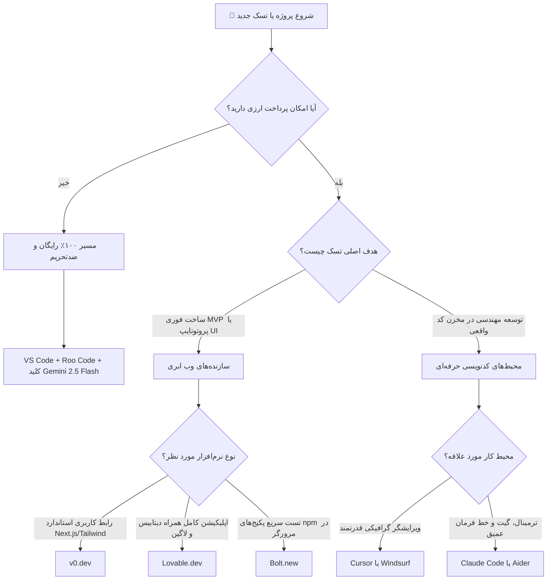

<div dir="rtl">

# 🤖 راهنمای جامع و نقشه انتخاب ابزارهای هوش مصنوعی (Agents & Tools Hub)

در پارادایم **وایب‌کدینگ (Vibe Coding)**، نحوه کار ما با نرم‌افزار دستخوش یک جهش کوانتومی شده است. در اواخر سال ۲۰۲۶، دیگر بحث بر سر این نیست که «کدام مدل هوش مصنوعی در چت بهتر کد می‌نویسد»، بلکه رقابت بر سر این است که **«کدام ایجنت (Agent) بیشترین آگاهی از کانتکست (Context Awareness) را دارد، ابزارهای محیطی (Tools) را هوشمندانه‌تر مدیریت می‌کند، تست‌ها را به شکل خودمختار اجرا می‌نماید و در جریان مهندسی واقعی کمتر دچار توهم (Hallucination) می‌شود؟»**

این راهنما مرجع تصمیم‌گیری شما برای انتخاب، ترکیب و استقرار ابزارهای هوش مصنوعی با در نظر گرفتن چالش‌های بومی توسعه‌دهندگان ایرانی (تحریم‌ها، عدم دسترسی آسان به کارت‌های اعتباری بین‌المللی و ناپایداری‌های شبکه) است.

---

## 📈 سیر تحول ابزارهای کدنویسی: از Autocomplete تا ایجنت‌های خودمختار

برای درک درست جایگاه هر ابزار، باید ۳ نسل تحول در کدنویسی با هوش مصنوعی را بشناسیم:

```
[نسل اول: تکمیل خودکار خطی] ──> [نسل دوم: گفتگو در پنل جانبی] ──> [نسل سوم: ایجنت‌های خودمختار محیط توسعه]
    GitHub Copilot (2021)              ChatGPT / Copilot Chat (2023)            Cursor / Windsurf / Claude Code (2025-2026)
    • پیش‌بینی خط بعدی کد                • کپی-پیست دستی قطعه‌کدها                • خواندن، تحلیل و ایندکس کل کدبیس
    • بدون آگاهی از سایر فایل‌ها        • عدم دسترسی به شل و تست‌ها               • اجرای مستقل دستورات ترمینال و بیلد
    • صرفاً کاهش زحمت تایپ                • اتلاف زمان در تغییر کانتکست             • ساخت و ریفکتور همزمان ده‌ها فایل در لوپ
```

1. **نسل اول (تکمیل خودکار خطی - Inline Autocomplete):**  
   ابزارهایی مانند نسخه اولیه GitHub Copilot که صرفاً خط جاری یا چند خط قبل و بعد را تحلیل می‌کردند و ادامه کد یا امضای توابع را حدس می‌زدند.
2. **نسل دوم (دستیارهای گفتگو در پنل کناری - Sidebar Chat):**  
   کپی کردن کد در پنجره چت جانبی، پرسیدن سوال، درخواست بازنویسی و کپی-پیست مجدد کد اصلاح‌شده به ادیتور. این شیوه سرعت تایپ را بالا برد اما برنامه‌نویس را به «اپراتور کپی‌پیست» تبدیل کرد و خطاهای ناشی از جاافتادن وابستگی‌ها را افزایش داد.
3. **نسل سوم (ایجنت‌های خودمختار چندفایلی - Agentic Multi-File Tools):**  
   ابزارهای مدرن مانند Cursor Agent، Windsurf Cascade، Claude Code، Cline / Roo Code و GitHub Copilot Agent Mode. این ایجنت‌ها با تکیه بر چارچوب‌های ابزارمحور (Tool Use و MCP) به فایل‌های پروژه دسترسی دارند، تست‌ها و لینترها را در ترمینال اجرا می‌کنند، خطاهای کامپایل را می‌خوانند و تا زمان برطرف شدن کامل باگ، کد را در لوپ‌های بسته بازنویسی می‌کنند.

---

## ⚖️ جدول مقایسه جامع ابزارهای هوش مصنوعی ۲۰۲۶ (Master Comparison Table)

جدول زیر مقایسه دقیق ۹ ابزار کلیدی حال حاضر بر اساس معیارهای عملیاتی، هزینه‌ای، امکان اتصال کلید شخصی (BYOK) و حساسیت به موقعیت مکانی و تحریم‌های ایران است:

| نام ابزار | دسته‌بندی (Category) | بهترین کاربرد (Sweet Spot) | مدل قیمت‌گذاری و پلن رایگان | امکان اتصال API شخصی (BYOK) | وضعیت تحریم و حساسیت به IP ایران |
| :--- | :--- | :--- | :--- | :--- | :--- |
| **[Cursor](ide-agents.md#cursor)** | IDE اختصاصی (Forked VS Code) | توسعه حرفه‌ای و تجاری نرم‌افزار، پروژه‌های متوسط و بزرگ فول‌استک | ۱۴ روز تریال پرو، پلن رایگان با ۵۰ درخواست محدود، پلن حرفه‌ای ۲۰$/ماه | ⚠️ محدود و غیررسمی (تمرکز بر سابسکرایب پرو) | ⚠️ حساسیت متوسط (بلاک کلودفلر/IP؛ با پراکسی معتبر و تنظیم HTTP/1.1 حل می‌شود) |
| **[Windsurf](ide-agents.md#windsurf)** | IDE اختصاصی (Forked VS Code) | جریان تعاملی پیوسته با Cascade Flows و ایندکسینگ سبک کدبیس‌های بزرگ | پلن رایگان (تکمیل کد نامحدود + سهمیه محدود کسکید)، پلن پرو ۲۰$/ماه | ❌ (تنها در پلن‌های Enterprise) | ⚠️ حساسیت متوسط (بلاک IP کلودفلر؛ نیازمند تغییر IP یا پراکسی) |
| **[GitHub Copilot (Agent)](ide-agents.md#copilot-agent)** | افزونه رسمی مایکروسافت | محیط‌های سازمانی سنتی، پروژه‌های اکوسیستم دات‌نت، جاوا و پایتون | ۱۰$/ماه برای اشخاص (برای دانشجویان و نگه‌دارندگان متن‌باز معتبر رایگان)، ۱۹$/ماه Business | ❌ (محیط بسته مایکروسافت / Azure OpenAI) | ⚠️ حساسیت متوسط (مایکروسافت آی‌پی ایران را مسدود می‌کند؛ ریسک بن اکانت کمتر از آنتروپیک) |
| **[Cline / Roo Code](ide-agents.md#cline-roo-code)** | افزونه متن‌باز (VS Code Extension) | کنترل کامل بر هزینه‌ها، آزادی در انتخاب مدل، استفاده از سهمیه رایگان جیمیل و مدل‌های محلی | ۱۰۰٪ رایگان و متن‌باز (هزینه فقط به اندازه مصرف توکن ارائه‌دهنده انتخابی) | ✅ **پشتیبانی کامل و منعطف** (OpenRouter, Gemini, Ollama, Groq) | 🟢 **بهترین سازگاری و ضدتحریم** (کلاینت تحریم‌پذیر نیست؛ وابسته به ارائه‌دهنده انتخابی) |
| **[Claude Code](ide-agents.md#claude-code)** | ابزار خط فرمان / CLI Agent | ریفکتورینگ عمیق، مهاجرت استک‌ها، اجرای تست در لوپ، سرورهای لینوکسی و سشن‌های SSH | بر اساس مصرف توکن کلود (نیازمند اکانت کنسول Anthropic یا اشتراک Pro/Max) | ✅ (مبتنی بر کلید API آنتروپیک) | 🚫 **بسیار حساس و پرریسک** (آنتروپیک اکانت‌های متصل به هویت/IP ایران را فوراً مسدود می‌کند) |
| **[Aider](ide-agents.md#aider)** | ابزار خط فرمان / CLI Tool | جفت برنامه‌نویسی در ترمینال، کامیت‌های منظم گیت، پایبندی سخت‌گیرانه به TDD | کاملاً متن‌باز و رایگان (مصرف بر اساس API شخصی) | ✅ **پشتیبانی کامل** (پشتیبانی از هر مدل سازگار با OpenAI / LiteLLM) | 🟢 **بسیار عالی** (اجرای ۱۰۰٪ محلی؛ بدون نیاز به لاگین اجباری در پلتفرم خاص) |
| **[v0 (Vercel)](web-builders.md#v0)** | سازنده وب ابری (Cloud Web Builder) | پروتوتایپ فوق‌سریع رابط کاربری، تبدیل طرح دستی و فیگما به Next.js/Tailwind/shadcn | سهمیه کردیت روزانه رایگان، اشتراک پرو ۲۰$/ماه | ❌ | ⚠️ حساسیت به IP (داشبورد ورسل روی رنج‌های مستقیم ایران خطای ۴۰۳ می‌دهد) |
| **[Bolt.new](web-builders.md#bolt)** | محیط ابری در مرورگر (WebContainer) | ساخت سریع MVP فول‌استک در چند دقیقه، آزمایش پکیج‌های npm درون مرورگر | سهمیه توکن رایگان روزانه محدود، پلن حرفه‌ای ۲۰$/ماه | ❌ (در نسخه پیش‌فرض ابری) | ⚠️ حساسیت متوسط (نیازمند اتصال اینترنت پایدار با پینگ مناسب برای وب‌سوکت) |
| **[Lovable](web-builders.md#lovable)** | سازنده وب با تمرکز بر پروداکشن | توسعه وب‌اپلیکیشن‌های دیتابیس‌محور با اتصال مستقیم به Supabase و سینک دوطرفه گیت‌هاب | چند پیام اولیه رایگان، سپس پلن ماهانه ارزی (شروع از ۲۰$/ماه) | ❌ | ⚠️ نیازمند تغییر IP (سرویس دیتابیس Supabase متصل به آن رنج ایران را مسدود می‌کند) |

---

## 🎯 ماتریس تصمیم‌گیری: کدام ابزار برای شما ساخته شده است؟

هیچ ابزاری در تمام ابعاد برترین نیست. بر اساس بودجه، تجربه فنی، نوع پروژه و دسترسی‌های ارزی، یکی از سه سناریوی استاندارد زیر را دنبال کنید:

---

### 🟢 سناریوی A: بودجه صفر / بدون دسترسی به پرداخت ارزی (The Ultimate Free Stack)
> **مخاطب هدف:** دانشجویان، فریلنسرهای تازه‌کار و توسعه‌دهندگانی که کارت اعتباری بین‌المللی ندارند اما خواهان بالاترین کیفیت خروجی در استانداردهای تجاری هستند.

* **ترکیب برنده:** `VS Code رسمی` + افزونه `Roo Code` (یا `Cline`) + کلید رایگان `Google AI Studio (Gemini 2.5 Flash)`
* **چرا این استک بی‌رقیب است؟**
  1. **هزینه اشتراک ماهانه صفر:** هیچ نیازی به پرداخت ارزی یا خرید اکانت‌های واسط ۲۰ دلاری ندارید.
  2. **سهمیه روزانه سخاوتمندانه گوگل:** سرویس Google AI Studio به هر حساب جیمیل سهمیه رایگان روزانه با بیش از ۱۵ درخواست در دقیقه و پنجره کانتکست ۱ میلیون توکنی ارائه می‌دهد که برای پروژه‌های شخصی و کاری روزمره کافی است.
  3. **مصونیت در برابر بن شدن اکانت:** بر خلاف آنتروپیک و OpenAI که حساب‌های متصل به شماره یا هویت ایران را بلاک می‌کنند، گوگل رفتاری بسیار منعطف دارد و با تغییر آی‌پی ساده بدون مشکل سرویس می‌دهد.
  4. **پروتکل MCP و استقلال کامل ترمینال:** Roo Code درست مانند Cursor فایل‌ها را ویرایش می‌کند، دستورات ترمینال را اجرا می‌نماید و می‌تواند با Puppeteer مرورگر را برای تست UI باز کند.
  5. **پلن پشتیبان رایگان:** در صورت تکمیل سهمیه روزانه، می‌توانید از طریق **OpenRouter** به مدل‌های آزاد مانند `DeepSeek V3` و `Llama 3.3 70B` سوییچ کنید.
* **چه زمانی این سناریو مناسب نیست؟**
  * اگر به دنبال محیطی کاملاً پیکربندی‌شده و آماده (Out-of-the-box) هستید و تمایلی به مدیریت کلیدهای API، تنظیمات دستی مدل‌ها یا پیکربندی پرامپت‌های سیستمی ندارید.
  * اگر در پروژه‌های تیمی بزرگ نیاز به مدیریت متمرکز هزینه‌ها، کنترل سهمیه تیمی و لاگ‌های اداری یکپارچه دارید.

---

### 🔵 سناریوی B: توسعه‌دهنده حرفه‌ای فول‌استک (Professional Full-Stack Developer)
> **مخاطب هدف:** مهندسان ارشد نرم‌افزار، لیدهای فنی و فریلنسرهایی که درآمد ارزی یا توانایی خرید اکانت‌های پرو دارند و زمان برای آن‌ها باارزش‌ترین سرمایه است.

```
                  ┌────────────────────────────────────────────────────────┐
                  │             انتخاب برای توسعه‌دهنده حرفه‌ای             │
                  └──────────────────────────┬─────────────────────────────┘
                                             │
             ┌───────────────────────────────┼───────────────────────────────┐
             ▼                               ▼                               ▼
     [ Cursor ]                        [ Windsurf ]                   [ Claude Code ]
  تمرکز: تکامل‌یافته‌ترین ادیتور        تمرکز: یکپارچگی روان جریان ذهن       تمرکز: قدرت مطلق CLI و گیت
  • ابزار پیشرو Composer / Agent      • معماری Cascade و Flows        • فوق‌العاده برای TDD و معماری
  • اکوسیستم غنی قوانین (.cursorrules) • ایندکسینگ بسیار سبک Monorepo  • ادغام عمیق با Git و CI
  • پشتیبانی دیداری از Diff موازی    • حفظ تمرکز بدون پرامپت دستی     • سبک‌ترین مصرف رم بدون واسط گرافیکی
```

* **کرسر (Cursor):**
  * *چه زمانی انتخاب اول است؟* وقتی ادیتوری پایدار می‌خواهید که با کلید میانبر `Ctrl + I` فایل‌های چندگانه را بازنویسی کند، قوانین معماری تیم را با `.cursorrules` به هوش مصنوعی تحمیل نماید و با نمادهای `@Files` و `@Docs` کانتکست را به شکل موضعی کنترل کند.
  * *چه زمانی مناسب نیست؟* وقتی سیستم شما رم محدودی دارد (به دلیل ماهیت فورک الکترونی VS Code)، یا در شبکه‌هایی قرار دارید که استریم HTTP/2 در آن دچار اختلال است و نمی‌خواهید درگیر تنظیمات شبکه شوید.
* **ویندسرف (Windsurf):**
  * *چه زمانی برنده است؟* اگر در مخازن کد بسیار بزرگ (Monorepo) کار می‌کنید و نمی‌خواهید مداوم نام فایل‌ها را با `@` تگ کنید. موتور Cascade به صورت پویا تب‌های باز و تاریخچه ترمینال را رصد کرده و بدون قطع جریان فکری تغییرات را اعمال می‌کند.
  * *چه زمانی مناسب نیست؟* اگر به سیستم‌های پیشرفته قوانین چندسطحی ماژولار (مشابه `.cursor/rules/*.mdc`) وابسته هستید یا نیاز به اکوسیستم افزونه‌های جانبی بسیار گسترده دارید.
* **کلود کد (Claude Code):**
  * *چه زمانی بی‌رقیب است؟* اگر محیط کار اصلی شما لینوکس، ترمینال، سشن‌های سرور از راه دور (SSH) یا پایپ‌لاین‌های گیت است. کلود کد مستقیماً کامیت استاندارد می‌زند، تست‌ها را به شکل خودمختار تکرار می‌کند تا سبز شوند و بدون سربار UI سنگین کار می‌کند.
  * *چه زمانی مناسب نیست؟* اگر در محیط محلی پروکسی معتبر تنظیم نکرده‌اید (ریسک بن اکانت توسط آنتروپیک)، یا نیاز به پیش‌نمایش گرافیکی و بررسی دیداری خط به خط Diff کدهای فرانت‌اند دارید.

---

### 🟣 سناریوی C: ساخت فوق‌سریع MVP و رابط کاربری (Rapid Prototyping)
> **مخاطب هدف:** موسسان استارتاپ (Founders)، مدیران محصول، طراحان محصول و توسعه‌دهندگانی که می‌خواهند فرضیه کسب‌وکار را در کمتر از یک روز تست کنند.

1. **لاوبل (Lovable):**
   * *چه زمانی انتخاب اول است؟* وقتی به یک وب‌اپلیکیشن واقعی با قابلیت ثبت‌نام کاربر، دیتابیس رابطه‌ای، آپلود فایل و ذخیره‌سازی داده نیاز دارید. Lovable به طور خودکار به Supabase متصل شده و دیتابیس را پیکربندی می‌کند.
   * *چه زمانی مناسب نیست؟* وقتی پروژه شما متکی بر منطق‌های تجاری عمیق، الگوریتم‌های پیچیده مالی یا پردازش‌های پس‌زمینه سنگین است، یا کردیت‌های ماهانه ارزی برای ادامه چت تمام شده است.
2. **بولت (Bolt.new):**
   * *چه زمانی انتخاب اول است؟* وقتی می‌خواهید کدهای فول‌استک را با هر پکیج npm درون کانتینر مرورگر بدون نصب ابزار روی سیستم آزمایش کنید و به صورت آنی نتیجه را ببینید.
   * *چه زمانی مناسب نیست؟* وقتی اتصال اینترنت با تاخیر بالا یا ناپایدار دارید، زیرا سشن WebContainer در صورت قطع ارتباط مرورگر دچار اختلال می‌شود.
3. **پلتفرم v0 (محصول Vercel):**
   * *چه زمانی انتخاب اول است؟* وقتی به زیباترین، تمیزترین و استانداردترین رابط کاربری فرانت‌اند مبتنی بر Next.js، Tailwind CSS و shadcn/ui نیاز دارید تا مستقیماً به کدبیس اصلی خود کپی کنید.
   * *چه زمانی مناسب نیست؟* وقتی انتظار دارید ابزار برای شما بک‌اند کامل، سرویس احراز هویت یا وب‌سوکت راه‌اندازی کند؛ v0 متخصص فرانت‌اند و کامپوننت است، نه معماری دیتابیس.

---

## 🧭 درخت تصمیم‌گیری سریع (Quick Decision Tree)

برای انتخاب سریع نقطه شروع پروژه بر اساس منابع و اهداف خود، مسیر این فلوچارت را دنبال کنید:



---

## 📚 ساختار و مستندات تخصصی این بخش

برای ورود به جزئیات فنی و پیکربندی عملیاتی هر شاخه، اسناد زیر را مطالعه کنید:

* 💻 **[دستیارهای محیط توسعه و خط فرمان (ide-agents.md)](ide-agents.md):**  
  بررسی عمیق معماری Composer در Cursor، جریان Cascade در Windsurf، قابلیت‌های خودکار Roo Code، ابزارهای خط فرمان Claude Code و Aider و حالت ایجنت GitHub Copilot.
* 🌐 **[سازنده‌های فول‌استک ابری و ورک‌فلو طلایی (web-builders.md)](web-builders.md):**  
  راهنمای کار با v0، Lovable، Bolt، Replit Agent، Project IDX و آموزش گام‌به‌گام «ورک‌فلو طلایی انتقال پروژه (قانون ۷۰/۳۰)».
* 🛡️ **[راهنمای اتصال، رفع تحریم و تنظیمات شبکه (bypass-sanctions-dns.md)](bypass-sanctions-dns.md):**  
  بررسی سطوح تحریم سرویس‌ها، ریشه‌یابی شکست DNSها در استریم هوش مصنوعی، تنظیمات پراکسی در VS Code و شل، و رفع خطاهای HTTP/2 و SSL.

---

### 🗺️ ناوبری سریع در این بخش (Quick Navigation)

| سند | توضیحات محتوا | وضعیت |
| :--- | :--- | :---: |
| 🤖 **[راهنمای جامع و ماتریس انتخاب (README.md)](README.md)** | مقایسه همه‌جانبه ۹ ابزار، سیر تحول ایجنت‌ها و سناریوهای تصمیم‌گیری | **(سند فعلی)** |
| 💻 **[دستیارهای IDE و ابزارهای CLI (ide-agents.md)](ide-agents.md)** | آموزش کامل Cursor, Windsurf, Cline/Roo Code, Copilot Agent, Claude Code, Aider | [مشاهده سند](ide-agents.md) |
| 🌐 **[سازنده‌های وب ابری و ورک‌فلو طلایی (web-builders.md)](web-builders.md)** | بررسی v0, Lovable, Bolt, Replit, IDX و متدولوژی انتقال پروژه ۷۰/۳۰ | [مشاهده سند](web-builders.md) |
| 🛡️ **[راهنمای جامع رفع تحریم و شبکه (bypass-sanctions-dns.md)](bypass-sanctions-dns.md)** | حل خطای ۴۰۳، رفع قطعی HTTP/2، تنظیمات پراکسی ادیتور و متغیرهای ترمینال | [مشاهده سند](bypass-sanctions-dns.md) |

<div align="center">

**[🏠 بازگشت به صفحه اصلی ریپوزیتوری (Root README)](../README.md)**

</div>

</div>
