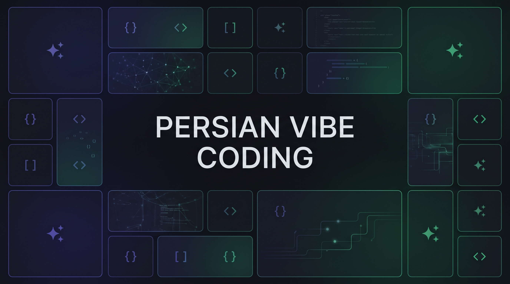

  

   
   

  <h1>✨ Persian Vibe Coding | مرجع جامع وایب‌کدینگ فارسی ✨</h1>
  
<b>کامل‌ترین راهنما، ابزارها، قوانین (Rules)، مهارت‌ها (Skills) و ورک‌فلوهای کدنویسی با هوش مصنوعی برای توسعه‌دهندگان فارسی‌زبان</b>

  

    
    
    
  

---

## 🎯 وایب‌کدینگ (Vibe Coding) چیست و چرا این ریپو ساخته شد؟

**وایب‌کدینگ** یعنی تغییر نقش برنامه‌نویس از «تایپیست کد» به **«معمار و کارگردان محصول»**. در این روش، شما با استفاده از ایجنت‌های هوش مصنوعی، قوانین مهندسی‌شده (Rules) و مهارت‌های ماژولار (Skills)، ایده‌هایتان را با سرعت ۱۰ برابر به محصول واقعی تبدیل می‌کنید.

اما توسعه‌دهندگان ایرانی در این مسیر با چالش‌های خاصی روبرو هستند: **تحریم‌ها، محدودیت پرداخت ارزی برای APIها، به‌هم‌ریختگی رابط کاربری راست‌چین (RTL)، عدم آشنایی مدل‌ها با سرویس‌های ایرانی (زرین‌پال، کاوه‌نگار و...) و تبدیل شدن پروژه به کد اسپاگتی در مرحله دیپلوی.**

هدف این ریپوزیتوری این است که یک **جعبه ابزار عملی و Plug & Play** باشد تا بتوانید روی هر پروژه‌ای مستقیم از آن استفاده کنید.

---

## ⚡ شروع سریع (در کمتر از ۲ دقیقه)

چطور از این ریپوزیتوری در پروژه فعلی خودتان استفاده کنید؟

1. **تنظیم قوانین پایه (Rules):** وارد پوشه [`03-rules`](./03-rules) شوید، فایل متناسب با استک خودتان (مثلاً Next.js یا FastAPI) را به همراه فایل استاندارد فارسی (`persian-rtl-standard.md`) کپی کرده و در ریشه پروژه‌تان با نام `.cursorrules` یا `CLAUDE.md` قرار دهید.
2. **افزودن مهارت به ایجنت (Skills):** از پوشه [`04-skills`](./04-skills) مهارت‌های مورد نیازتان (مثل درگاه پرداخت ایرانی یا داکرایز خودکار) را داخل پوشه `.claude/skills` یا `.cursor/rules` کپی کنید.
3. **اتصال API رایگان:** اگر اکانت پریمیوم ندارید، طبق راهنمای [`02-free-apis-and-models`](./02-free-apis-and-models) کلید رایگان Gemini یا OpenRouter را بگیرید و روی افزونه Cline یا Roo Code ست کنید.

---

## 🗺️ نقشه راه و فهرست بخش‌های ریپوزیتوری

| بخش | عنوان و محتوا | مناسب برای چه کسانی؟ |
| :--- | :--- | :--- |
| **۰۱** | 🤖 [**ایجنت‌ها و ابزارهای کدنویسی**](./01-agents-and-tools/README.md) مقایسه تخصصی Cursor, Windsurf, Claude Code, Cline, Lovable, Bolt و راهنمای عبور از تحریم | انتخاب بهترین ابزار متناسب با بودجه و نوع پروژه |
| **۰۲** | 🔑 [**بانک APIهای رایگان و مدل‌های لوکال**](./02-free-apis-and-models/README.md) دریافت API رایگان از Google AI Studio, Groq, OpenRouter، اجرای مدل با Ollama و واسط‌های ریالی | کدنویسی نامحدود با هوش مصنوعی بدون نیاز به کارت ارزی |
| **۰۳** | 📏 [**قوانین استاندارد (`.cursorrules` / `CLAUDE.md`)**](./03-rules/README.md) قوانین آماده کپی برای تمیزنگه‌داشتن کد، رعایت استاندارد RTL، تاریخ شمسی و استک‌های مختلف | جلوگیری از تولید کدهای کثیف و باگ‌دار توسط هوش مصنوعی |
| **۰۴** | 🧠 [**مهارت‌های ایجنت (Agent Skills)**](./04-skills/README.md) پکیج‌های مهارتی آماده: اتصال به درگاه پرداخت و پیامک ایرانی، ممیزی امنیت، داکرایز و ریفکتور | آموزش تخصص‌های بومی و مهندسی به ایجنت کدنویسی |
| **۰۵** | 🔌 [**سرورهای MCP (Model Context Protocol)**](./05-mcp-servers/README.md) اتصال مستقیم ایجنت به دیتابیس Postgres، گیت‌هاب، مرورگر و داکیومنت‌های به‌روز | دادن دسترسی عملیاتی و ابزارهای خارجی به ایجنت |
| **۰۶** | 📝 [**پرامپت‌های سیستم و ورک‌فلوها**](./06-prompts-and-workflows/system-prompts.md) پرامپت‌های مهندسی‌شده برای تبدیل ایده به PRD، دیباگ عمیق و ساخت MVP در یک آخر هفته | کسانی که می‌خواهند صفر تا صد یک محصول را استاندارد جلو ببرند |
| **۰۷** | 🚀 [**دیپلوی، امنیت و نگهداری در پروداکشن**](./07-deploy-and-maintain/README.md) دیپلوی روی سرویس‌های ایرانی (پاستاکلود، آروان) و خارجی (Vercel, Railway)، چک‌لیست امنیت و گیت | حل مشکل «روی سیستم خودم کار می‌کنه ولی روی سرور نه!» |
| **۰۸** | 💡 [**بانک ایده‌ها و پروژه‌های آماده شروع**](./08-ideas-and-starters/weekend-projects.md) ایده‌های پروژه آخر هفته و Micro-SaaS به همراه معماری پیشنهادی و پرامپت شروع سریع | کسانی که دنبال ایده برای تمرین یا ساخت محصول درآمدزا هستند |

---

## 🧩 تفاوت Rules، MCP و Skills در یک نگاه

اگر تازه وارد دنیای ایجنت‌ها شده‌اید، این سه مفهوم ستون‌های اصلی پروژه شما هستند:

* **قوانین (`03-rules`):** خط قرمزها، معماری و سلیقه کدنویسی شماست که **همیشه در پس‌زمینه فعال است** (مثلاً: «همیشه از TypeScript استفاده کن و هیچ فایلی بیشتر از ۲۵۰ خط نشود»).
* **مهارت‌ها (`04-skills`):** دستورالعمل‌های تخصصی و گام‌به‌گامی که ایجنت **فقط در زمان نیاز** سراغشان می‌رود (مثلاً: «وقتی گفتم درگاه پرداخت اضافه کن، طبق فایل مهارت زرین‌پال کد بزن»).
* **پروتکل (`05-mcp-servers`):** دست و پای ایجنت برای تعامل با محیط بیرون است (مثلاً اجرای مستقیم کوئری روی دیتابیس یا خواندن Issueهای گیت‌هاب).

---

## 🤝 چطور در این پروژه مشارکت کنیم؟

این ریپوزیتوری متعلق به تمام کامیونیتی فارسی است! اگر پرامپت خفنی دارید، ابزار جدیدی کشف کرده‌اید، یا برای استک خاصی فایل Rule و Skill نوشته‌اید:

1. راهنمای مشارکت را در فایل [**CONTRIBUTING.md**](./CONTRIBUTING.md) بخوانید.
2. ریپو را Fork کنید، تغییراتتان را اعمال کنید و یک **Pull Request** بفرستید.
3. همچنین می‌توانید در بخش [Issues](https://github.com/amirrezahajiabadi/persian-vibe-coding/issues) ایده‌ها یا باگ‌ها را مطرح کنید.

---

## ❤️ حمایت از پروژه

اگر این ریپوزیتوری برایتان مفید بود، با دادن یک **ستاره (⭐️ Star)** در بالای صفحه و اشتراک‌گذاری آن با دوستانتان، کمک کنید تا توسعه‌دهندگان بیشتری با استانداردهای درست وایب‌کدینگ آشنا شوند.

